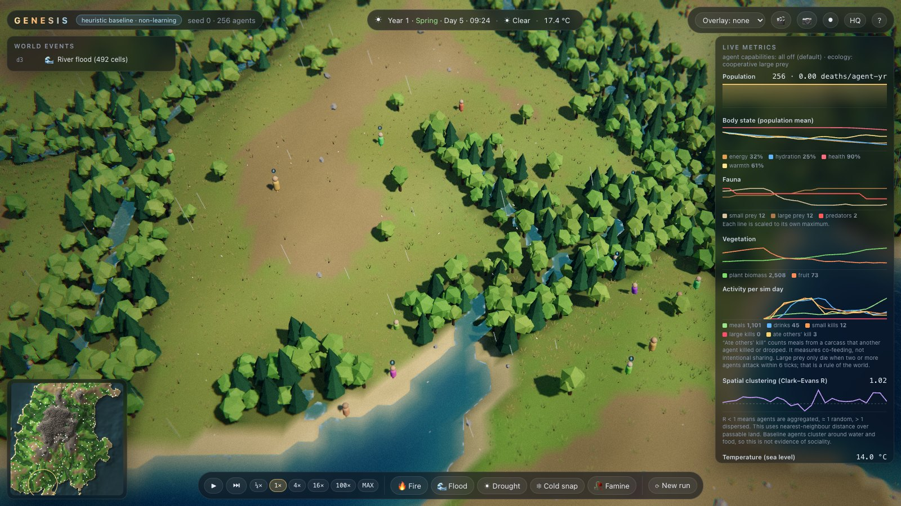

# GENESIS

An artificial-life testbed for one question: **what social organisation and culture emerge when
minimally specified learning agents are rewarded only for staying alive?** Agents are never rewarded
for anything social; sharing, grouping, signalling or norms must emerge, or be reported as absent.

Status: **Stage 1 (world engine) complete, with Stage 1.1 tuning** (food-limited fauna; 112k steps/min with full observations for 1,000 agents),
plus the **first slice of the live 3-D viewer** (Stage 5). Handoff notes: [HANDOFF.md](HANDOFF.md). See [PLAN.md](PLAN.md) for all stages and
[reports/stage1/STAGE1_REPORT.md](reports/stage1/STAGE1_REPORT.md) for the evidence.

## Setup (macOS / Linux, Python 3.11 via uv)

```bash
make setup
```

```bash
make test
```

## Live viewer

```bash
make viewer-setup     # once (aiohttp + three.js via npm)
make viewer           # then open http://localhost:8787
```

The viewer shows the world in 3-D, with agents, animals, weather, seasons, fires and floods, plus live metrics. You can
inspect any agent, change speed, and trigger disturbances. Every action is logged. Agents are driven by a non-learning
baseline until Stage 2. Details: [docs/VIEWER.md](docs/VIEWER.md).



## Recording and learning material
- Every viewer and experiment run records **every agent at every tick** (state, action, reward, death) in `runs/<run>/trajectory/`,
  and can be replayed bit-exactly: `python -m analysis.trajectories runs/<run> --verify`. See `sim/recorder.py`.
- New to reinforcement learning? Read [TEACHER.md](TEACHER.md). It explains the concepts through GENESIS and has an FAQ.

## Run

```bash
make baselines
```

```bash
make evidence
```

```bash
make bench
```

Minimal use of the engine:

```python
import numpy as np
from sim import GenesisEnv, load_config
from agents.baselines import make_baseline

env = GenesisEnv(load_config("configs/default.yaml"), seed=0)  # 256x256 world, 256 agents
policy = make_baseline("heuristic", env)
obs = env.observe()
for _ in range(3840):                                          # one simulated year
    obs, rewards, died, info = env.step(policy.act(obs, env.alive))
print(env.metrics())
```

PettingZoo: `from sim.pz_env import parallel_env; env = parallel_env(seed=0)`.

## Layout
`sim/` engine · `agents/` baselines (learners in Stage 2) · `analysis/` metrics · `experiments/` scripts ·
`configs/` YAML · `tests/` · `reports/` figures and write-ups · `docs/` specs ([WORLD.md](docs/WORLD.md)) ·
`logs/AGENT_LOG.md` running log of how agents are doing · `viewer/` (Stage 5).
